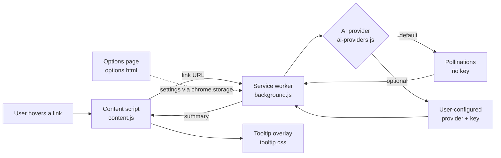

# PeekInsight — AI-powered link previews on hover

> Hover any link and get an instant AI summary of where it goes — before you click. Works out of the box, no API key.

[](LICENSE)
[](https://github.com/chirag127/peekinsight-bs-ext/stargazers)
[](https://github.com/chirag127/peekinsight-bs-ext/commits)
[](https://developer.chrome.com/docs/extensions/mv3/intro/)

**Live site:** https://peekinsight.oriz.in · **GHP landing:** https://chirag127.github.io/peekinsight-bs-ext/ · **Repo:** https://github.com/chirag127/peekinsight-bs-ext

⭐ If this is useful, please **star the repo** — it helps others find it.

---

## What it is / why it exists

Following a link is a gamble: you click, wait for a page to load, and only then learn whether it was worth it. **PeekInsight** is a Manifest V3 browser extension that closes that gap. Hover over any link and it fetches the target, distills it with an AI model, and shows a concise preview in a tooltip — so you decide *before* you commit a click and a tab.

It works out of the box using [Pollinations](https://pollinations.ai) with **no API key required**, and you can plug in your own provider/key from the options page if you prefer.

## How it works



## Features

- **Hover-to-preview** — an AI summary of a link's destination appears in a tooltip on hover.
- **Zero-config default** — ships with Pollinations, so it works immediately with no key.
- **Bring your own provider** — configure a custom AI provider and key from the options page.
- **Works everywhere** — `<all_urls>` content script, so previews work across the web.
- **Privacy-conscious** — settings live in `chrome.storage`; there is no PeekInsight backend.

## Tech stack

- **Manifest V3** browser extension (Chrome/Edge; Kiwi on mobile)
- Vanilla **JavaScript** — MV3 service worker (`background.js`) + content script (`content.js`)
- AI abstraction in `ai-providers.js` (Pollinations default)
- A companion static site (`index.html`) hosted at `peekinsight.oriz.in`

## Repo structure

```
extension/
  manifest.json      # MV3 manifest — name, permissions, entry points
  background.js       # service worker: brokers AI requests
  content.js          # injected on every page: hover detection + tooltip
  ai-providers.js     # provider abstraction (Pollinations default)
  options.html/.js    # settings UI (provider, key, prefs)
  popup.html/.js      # toolbar popup
  tooltip.css         # preview tooltip styling
index.html            # marketing/landing page (peekinsight.oriz.in)
privacy-policy.html   # store privacy policy
```

## Install

**From source (unpacked):**

1. `git clone https://github.com/chirag127/peekinsight-bs-ext && cd peekinsight-bs-ext`
2. Open `chrome://extensions` (or `edge://extensions`) and enable **Developer mode**.
3. Click **Load unpacked** and select the `extension/` folder.
4. Hover a link on any page to see a preview.

Mobile (Android): install via [Kiwi Browser](https://kiwibrowser.com) using the same unpacked flow. See [Installation-Instructions](https://installation-instructions.oriz.in) for step-by-step help.

## Configuration

Configured from the extension's **Options** page. No values are stored in this repo.

| Setting | Purpose |
|---|---|
| AI provider | Which backend generates the summary (Pollinations by default) |
| API key | Optional key when using a provider that requires one |
| Preview preferences | Length/behaviour of the hover tooltip |

## Part of the oriz family

PeekInsight is one of ~80 sites and tools in the **oriz** family. Read how the fleet is built and run at [blog.oriz.in](https://blog.oriz.in).

- **Cost:** the landing site is **$0 on the Cloudflare free tier**; the extension has no backend.
- **Related:** [ghosttyper-bs-ext](https://github.com/chirag127/ghosttyper-bs-ext) (inline AI writing), [Installation-Instructions](https://github.com/chirag127/Installation-Instructions) (how to install extensions).

## Contributing

Issues and PRs welcome. Conventional commits are the changelog.

## Status

Stable (v2.0.0).

## License

MIT © Chirag Singhal — chirag@oriz.in
